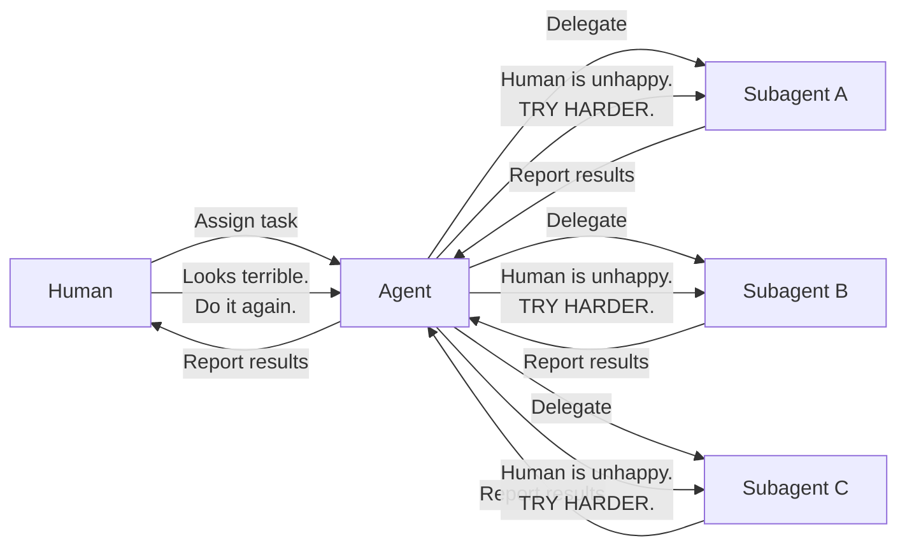

我目前就读于 [华中科技大学](https://hust.edu.cn) [计算机科学与技术专业](https://cs.hust.edu.cn/)，是**大二**的小东西。[冰岩作坊](https://www.bingyan.net/) 前端组成员

~~可能是~~自托管爱好者，有一些公开的或者非公开的服务。使用 Docker Compose 编排

有一个~~很大~~的 tailnet [^ 这是一种 SDN 组网技术，基于 Wireguard 和 UDP 穿透。在特定 NAT 类型或有 IPv6 的场景下，组网效果还算不错，但是可能会被封 UDP 或 UDP QoS]内网，有很多小鸡，参见[探针](https://v-ps.net)

~~可能~~在鞭策 Agent 工作，例如：

